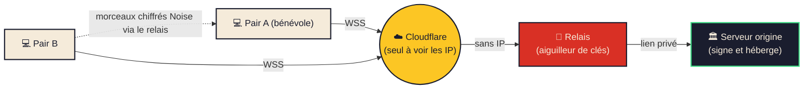

<div align="center">
  

  # T2C Phantom

  **« Le savoir ne devrait pas toujours dépendre d'une connexion centralisée. »**<br>

  <!-- CI & Distribution Badges -->
  <p>
    <a href="https://github.com/TUTODECODE-FR/T2C-Phantom/actions/workflows/ci.yml"></a>
    <a href="https://github.com/TUTODECODE-FR/T2C-Phantom/actions/workflows/osv-scanner.yml"></a>
    <a href="https://github.com/TUTODECODE-FR/T2C-Phantom/actions/workflows/codeql.yml"></a>
  </p>

  <p>
    <a href="https://golang.org/"></a>
    <a href="https://noiseprotocol.org/"></a>
    <a href="#"></a>
    <a href="#"></a>
    <a href="#"></a>
  </p>

  <!-- OpenSSF Badges -->
  <p>
    <a href="https://github.com/TUTODECODE-FR/T2C-Phantom/actions/workflows/scorecard.yml"></a>
  </p>
  
  <br>
  <p>
    <b>Le Moteur Réseau Pair-à-Pair de l'Écosystème Éducatif T2DECODE.</b><br>
    <i>Pairs pseudonymes · Bénévoles audités · Chiffré de bout en bout · Contenu signé</i>
  </p>
  <br>
</div>


## 🎯 Pourquoi T2C Phantom ?
Alors qu'il existe déjà des réseaux éprouvés comme IPFS, Tor, ou BitTorrent, pourquoi avoir créé T2C Phantom ?
- **IPFS** est excellent pour le stockage public, mais lourd et complexe pour un chiffrement privé de bout-en-bout.
- **Tor** offre un anonymat fort au détriment de la vitesse et souffre souvent de blocages institutionnels (nœuds publics).
- **T2C Phantom** est un compromis spécifique : un moteur réseau léger (conçu pour l'embarqué et les connexions instables), optimisé pour la distribution de modules éducatifs chiffrés. Il encapsule son trafic dans des flux standards (WSS) pour garantir une haute disponibilité même dans les environnements restrictifs (universités, réseaux d'entreprise).

## ⚠️ PROPRIÉTÉ INTELLECTUELLE & LICENCE
> [!WARNING]
> **PROPRIÉTÉ INTELLECTUELLE & LICENCE**
> Ce dépôt public publie le **client** (daemon) en source-available : vous pouvez l'auditer et prouver l'absence de porte dérobée. **Ce n'est PAS open source** (pas GPLv3, pas MIT). Tous droits réservés TUTODECODE.
> Le **code serveur / relais** n'est pas publié, pour des raisons de sécurité (nœuds empoisonnés / Sybil, topologie).
> Utilisation, modification, distribution ou intégration commerciale par un tiers : **interdites** sans accord écrit de TUTODECODE.

**Pourquoi cette protection (Transparence Hybride) ?**
La mécanique côté client est publique pour l'audit. Le relais reste privé pour limiter la rétro-ingénierie et les nœuds malveillants.


## 🧠 Architecture

Les utilisateurs sont des **pairs pseudonymes** : chacun n'est qu'une clé générée au hasard sur sa machine. **Seul Cloudflare voit leur IP** ; le relais (VPS), le serveur origine et les autres pairs ne voient que des clés. Les sites sont **hébergés par des bénévoles** et transitent entre pairs **chiffrés de bout en bout** ; chaque morceau est vérifié contre un manifeste **signé par l'origine**, donc personne ne peut modifier un site en route.



| Rôle | Ce qu'il fait | Ce qu'il voit |
|------|---------------|---------------|
| **Pair** (`t2c`) | Télécharge chez plusieurs bénévoles en parallèle, vérifie chaque morceau, héberge une copie s'il est bénévole | Les clés des bénévoles, jamais leur IP |
| **Relais** (privé) | Aiguille des messages chiffrés entre clés, sert le catalogue signé, audite les bénévoles, repli sur l'origine | Des clés pseudonymes, jamais d'IP |
| **Origine** (privée) | Héberge et signe les sites, délivre les tickets de bénévolat, tient le score | Rien des utilisateurs (refuse toute requête portant un header d'IP) |

### 🔒 Primitives

| Élément | Technologie | Rôle |
|---------|-------------|------|
| Identité | Ed25519 + preuve de travail | Clé aléatoire ; recréer une identité après un ban coûte du calcul |
| Authenticité | Ed25519 (clé de l'origine) | Catalogue, manifestes, liste des bénévoles et tickets signés |
| Intégrité | SHA-256 par morceau de 256 Ko | Toute modification par un bénévole est détectée |
| Bout en bout | Noise IK (X25519 / ChaCha20-Poly1305 / BLAKE2s) | Le relais ne lit pas les échanges entre pairs |
| Transport | WebSocket TLS via Cloudflare | Port 443 standard |
| Confiance des bénévoles | Audits de stockage + score signé | Copie non conforme → ticket révoqué → ban |

## 🛡️ Modèle de menace

| Menace | Protection |
|--------|-----------|
| Bénévole qui modifie un site (virus, contenu) | ✅ Morceau rejeté (hash ≠ manifeste signé), bénévole banni localement, signalé, audité, banni par l'origine |
| Relais compromis | ✅ Ne peut ni lire les échanges entre pairs ni falsifier un site (pas la clé de signature) ; ⚠️ peut voir qui échange avec qui (sous forme de clés) et refuser le service |
| Relais / origine qui voudraient l'IP d'un utilisateur | ✅ Ils ne la reçoivent pas ; l'origine refuse même toute requête qui en porterait une |
| Vieux catalogue rejoué | ✅ Version signée croissante, retour en arrière refusé |
| Flood / DDoS | ✅ Cloudflare devant ; limites par clé au relais ; PoW d'identité ; le relais n'accepte que Cloudflare |
| Cloudflare | ⚠️ Voit l'IP et les requêtes envoyées au relais (pas le contenu échangé entre pairs) |
| Poste client compromis | ❌ Hors périmètre |

**Limite assumée** : les pairs ne se connectent jamais directement (sinon ils verraient leurs IP). Tout le trafic passe par le relais, chiffré : les données viennent des bénévoles, mais l'aiguillage est central et la bande passante du VPS est la limite.


## 🚀 Démarrage rapide

```bash
git clone https://github.com/TUTODECODE-FR/T2C-Phantom.git && cd T2C-Phantom
# la clé publique racine est fournie par TUTODECODE
go build -ldflags "-X t2c/pkg/trust.RootPubKeyHex=<clé publique>" -o t2c ./cmd/t2c
./t2c doctor
./t2c start            # proxy .t2c sur 127.0.0.1:8080, bénévole pour les sites visités
./t2c dashboard        # interface sur http://127.0.0.1:9090
```

Navigateur : proxy HTTP `127.0.0.1:8080`, puis `http://tutodecode.t2c`. Pour le HTTPS `.t2c`, importer la CA locale `tutodecode-ca.crt` (générée sur ta machine, elle ne signe que les sites du catalogue).

Le code du relais et de l'origine n'est pas publié (voir Licence) ; le client ci-dessus suffit pour rejoindre le réseau.


## ❓ Foire Aux Questions (FAQ)

**1. Pourquoi le relais public n'est-il pas Open Source ?**  
Pour protéger la topologie réseau de TUTODECODE contre les attaques Sybil (création massive de faux nœuds). La sécurité de l'utilisateur final est assurée par le code client (qui est auditable) et le chiffrement de bout-en-bout.

**2. Le réseau fonctionne-t-il sans Internet ?**  
Les sites déjà téléchargés restent consultables hors ligne (cache local). Pour récupérer un nouveau site, il faut joindre le relais.

**3. Les données des cours sont-elles stockées localement ?**  
Absolument. T2DECODE est une application "Offline-First". T2C Phantom est uniquement utilisé pour la mise à jour asynchrone des paquets éducatifs.

**4. Comment devenir bénévole ?**  
`t2c start` héberge par défaut une copie des sites visités (`-no-volunteer` pour refuser). Le relais vérifie régulièrement que ta copie est intacte ; ton score monte à chaque audit réussi.


## 🗺️ Roadmap (Feuille de Route)

Le protocole évolue pour offrir une résilience encore plus forte face à la censure.

```text
v2.0 (fait)
- Pairs pseudonymes (clé aléatoire + PoW), seul Cloudflare voit les IP.
- Bénévoles, tickets signés, audits de stockage, score et ban signés par l'origine.
- Échanges entre pairs chiffrés de bout en bout via le relais.

v2.1
- Plusieurs relais (fédération) pour supprimer le point unique d'aiguillage.
- Téléchargement reprenable et cache disque des morceaux.
```

## 💖 Soutenir le Projet (Donation)

T2C-Phantom et T2DECODE sont développés de manière indépendante et à but non lucratif. Si vous appréciez notre démarche d'éducation souveraine et sans traçage, vous pouvez soutenir notre association loi 1901 :

[](https://liberapay.com/tutodecode/donate)

### Indicateurs de l'Association sur LiberaPay

<div align="center">
  <a href="https://liberapay.com/tutodecode/donate">
    
  </a>
  <a href="https://liberapay.com/tutodecode/donate">
    
  </a>
  <a href="https://liberapay.com/tutodecode/donate">
    
  </a>
</div>

### Liens Liberapay
*   [Profil Principal](https://liberapay.com/tutodecode/)
*   [Faire un don direct](https://liberapay.com/tutodecode/donate)
*   [Widget d'encaissements](https://liberapay.com/tutodecode/receiving)
*   [Widget de dons](https://liberapay.com/tutodecode/giving)


## 🏛️ L'Association TUTODECODE (Mentions Légales)

Le projet T2DECODE est développé et soutenu par l'**Association TUTODECODE**, structure relevant de l'Économie Sociale et Solidaire (ESS).  
Notre mission est de démocratiser la maîtrise des infrastructures informatiques et de la cybersécurité en fournissant des outils souverains et respectueux de la vie privée.

- **Éditeur** : Association Loi 1901 TUTO DECODE
- **Directeur de Publication** : Maxime MARTIN CIVET
- **SIREN** : 102 763 133
- **Site Web Officiel** : [https://tutodecode.org](https://tutodecode.org)
- **Preuve Légale** : [Annonce de création parue au JOAFE](https://www.journal-officiel.gouv.fr/pages/associations-detail-annonce/?q.id=id:202600110336)
- **Engagement de Confidentialité** : [Consulter notre Politique RGPD](RGPD.md)

---
<div align="center">
  <i>© 2026 TUTODECODE - Tous droits réservés.</i>
</div>
