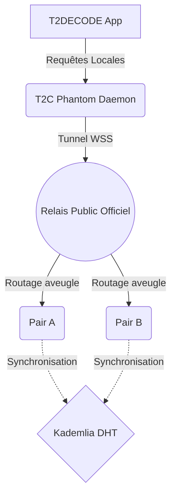

<div align="center">
  

  # T2C Phantom

  **« Le savoir ne devrait pas toujours dépendre d'une connexion centralisée. »**<br>

  []()
  []()
  []()
  []()
  
  <br>
  <p>
    <b>Le Moteur Réseau Pair-à-Pair de l'Écosystème Éducatif T2DECODE.</b><br>
    <i>NAT Traversal · Kademlia DHT · Zero-Trust · Air-Gapped Ready</i>
  </p>
  <br>
</div>


## 🎯 Pourquoi T2C Phantom ?
Alors qu'il existe déjà des réseaux éprouvés comme IPFS, Tor, ou BitTorrent, pourquoi avoir créé T2C Phantom ?
- **IPFS** est excellent pour le stockage public, mais lourd et complexe pour un chiffrement privé de bout-en-bout.
- **Tor** offre un anonymat fort au détriment de la vitesse et souffre souvent de blocages institutionnels (nœuds publics).
- **T2C Phantom** est un compromis spécifique : un moteur réseau léger (conçu pour l'embarqué et les connexions instables), optimisé pour la distribution de modules éducatifs chiffrés. Il encapsule son trafic dans des flux standards (WSS) pour garantir une haute disponibilité même dans les environnements restrictifs (universités, réseaux d'entreprise).

## ⚠️ PROPRIÉTÉ INTELLECTUELLE & LICENCE
> [!CAUTION]
> **Ce dépôt est "Source-Available" (Auditable) mais n'est PAS Open Source.**
> Le code de T2C Phantom est maintenu sous propriété intellectuelle stricte (**Tous droits réservés**). 
> L'utilisation, la modification, la distribution ou l'intégration commerciale de ce moteur réseau par des entités tierces est **formellement interdite** sans accord écrit de TUTODECODE.

**Pourquoi cette protection (Transparence Hybride) ?**
La mécanique côté client est auditable pour prouver l'absence de portes dérobées. En revanche, le code source des Relais publics est gardé confidentiel. Ce choix vise à mitiger la rétro-ingénierie par des acteurs malveillants souhaitant créer des nœuds empoisonnés (Attaques Sybil) et préserver l'intégrité de la topologie.


## 🧠 Architecture et Modèle Théorique

T2C Phantom repose sur un modèle d'architecture décentralisée (Swarm/Mesh) garantissant l'accès à la connaissance sans point de défaillance unique. L'application cliente (T2DECODE) s'appuie sur ce daemon réseau pour interroger l'essaim et synchroniser les cours de manière chiffrée.

### Schéma Conceptuel



### Principes Clés
- **Résilience en Milieux Restreints** : Le trafic est encapsulé dans WSS (HTTPS/TLS sur le port 443), ce qui améliore la résilience face à certains systèmes de filtrage DPI (Deep Packet Inspection) en simulant une navigation web standard.
- **Chiffrement Emboîté (Zero-Trust)** : Le réseau applique un chiffrement de bout-en-bout (Protocole Noise / AES-GCM). Même si le trafic transite par des relais publics, ceux-ci n'ont accès ni à la clé ni aux données.
- **Annuaire Décentralisé (Kademlia DHT)** : Il n'y a aucun serveur d'adressage. La résolution de noms (ex: `tutodecode.t2c` -> Peer ID) s'effectue via un résolveur DNS local basé sur le fichier `carnet.json`.


## 🛡️ Modèle de Menace (Ce que nous couvrons)

La transparence est la fondation de la confiance. Voici une évaluation réaliste des protections offertes par T2C Phantom :

| Menace | Protection | Explication |
|--------|------------|-------------|
| **Espionnage du trafic local** | ✅ Oui | Chiffrement WSS + Protocole Noise de bout-en-bout. |
| **Relais malveillant** | ✅ Oui | Le relais agit comme un routeur aveugle. Il ne détient pas les clés de déchiffrement. |
| **Blocage institutionnel standard** | ⚠️ Partiel | Le port 443 limite le filtrage de base, mais une inspection SSL avancée avec certificats Root injectés bloquera la connexion. |
| **Attaque étatique ciblée** | ❌ Non | Le protocole n'est pas conçu pour résister à des acteurs étatiques dédiés (NSA, etc.). Ce n'est pas un outil de dissidence. |
| **Compromission du poste client** | ❌ Non | Si l'OS de l'utilisateur est infecté (malware, keylogger), le chiffrement réseau devient inutile. |


## 📊 Métriques Techniques (Estimations)

T2C Phantom a été conçu pour l'efficacité et la légèreté, afin de tourner en tâche de fond sans perturber le poste utilisateur.

- **Empreinte mémoire (RAM)** : ~25 Mo en fonctionnement normal.
- **Temps de démarrage (Bootstrapping)** : ~3 secondes.
- **Support des pairs (Swarm)** : Jusqu'à 150 connexions simultanées par nœud sans dégradation de performance.
- **Taille du binaire (Go)** : ~15 Mo (Standalone, aucune dépendance).


## 🚀 Guide Rapide : Installation et Utilisation

Le binaire est autonome et Air-Gapped ready. Une fois téléchargé depuis la section **Releases**, voici la marche à suivre :

### 1. Démarrer le Nœud Local
Ouvrez votre terminal dans le dossier contenant l'exécutable et lancez le démon. Pour vous connecter au réseau en traversant les NAT, utilisez le relais public :

```bash
# Sur Mac/Linux :
./t2c start --proxy 8080 --use-relay /ip4/20.244.4.32/tcp/443/wss/p2p/12D3KooWBEK7H1KXCgpUbD4pFeGJVjVoFfUhnwPH1ywvsTbn6BBr

# Sur Windows :
t2c.exe start --proxy 8080 --use-relay /ip4/20.244.4.32/tcp/443/wss/p2p/12D3KooWBEK7H1KXCgpUbD4pFeGJVjVoFfUhnwPH1ywvsTbn6BBr
```

### 2. Naviguer sur le réseau T2C
Laissez le terminal ouvert. Votre machine dispose désormais d'un accès au sous-réseau via le proxy local `127.0.0.1:8080`. 

Si vous disposez de l'annuaire `carnet.json`, vous pouvez interroger les nœuds de manière transparente :
```bash
curl -x http://localhost:8080 http://tutodecode.t2c
```


## ❓ Foire Aux Questions (FAQ)

**1. Pourquoi le relais public n'est-il pas Open Source ?**  
Pour protéger la topologie réseau de TUTODECODE contre les attaques Sybil (création massive de faux nœuds). La sécurité de l'utilisateur final est assurée par le code client (qui est auditable) et le chiffrement de bout-en-bout.

**2. Le réseau fonctionne-t-il sans Internet ?**  
Oui. T2C Phantom implémente mDNS et la diffusion UDP (LAN Discovery). Si plusieurs machines sont sur le même réseau local (sans routeur Internet), elles se découvriront et se synchroniseront automatiquement.

**3. Les données des cours sont-elles stockées localement ?**  
Absolument. T2DECODE est une application "Offline-First". T2C Phantom est uniquement utilisé pour la mise à jour asynchrone des paquets éducatifs.

**4. Puis-je héberger mon propre relais ?**  
Actuellement, le réseau s'appuie sur des relais de confiance pour éviter la pollution de la table DHT. L'hébergement communautaire non vérifié n'est pas encore supporté.


## 🏛️ L'Association TUTODECODE
Le projet est propulsé par l'**Association TUTODECODE** (Économie Sociale et Solidaire).  
Notre but : Démocratiser l'informatique souveraine, la cybersécurité, et l'apprentissage respectueux de la vie privée.

- 🌐 **Site Web** : [tutodecode.org](https://tutodecode.org)
- ☕ **Soutenez-nous** : [Faire un don via HelloAsso](https://www.helloasso.com/associations/tutodecode)

---
<div align="center">
  <i>© 2026 TUTODECODE - Tous droits réservés.</i>
</div>
