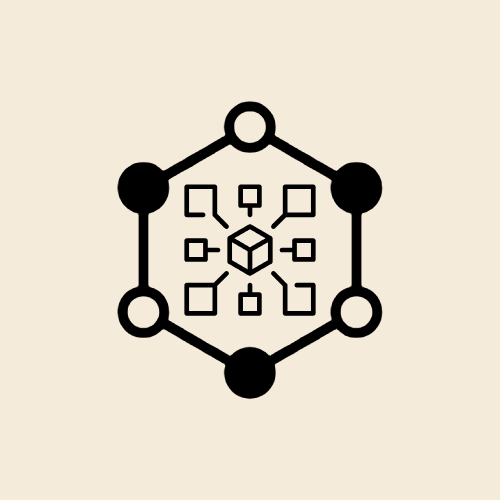
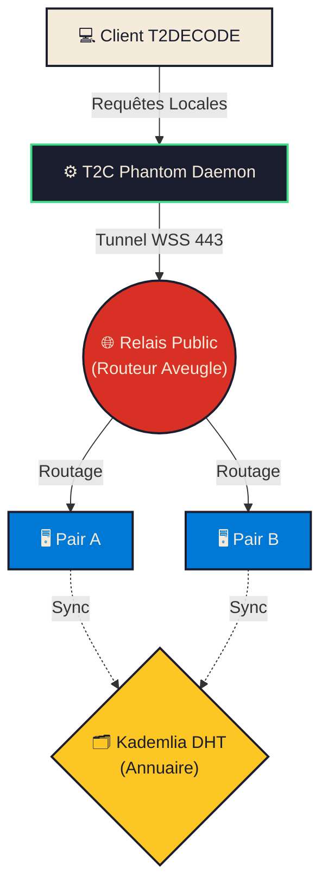

<div align="center">
  

  # T2C Phantom

  **« Le savoir ne devrait pas toujours dépendre d'une connexion centralisée. »**<br>

  <!-- CI & Distribution Badges -->
  <p>
    <a href="https://github.com/TUTODECODE-FR/T2C-Phantom/actions/workflows/ci.yml"></a>
    <a href="https://github.com/TUTODECODE-FR/T2C-Phantom/actions/workflows/osv-scanner.yml"></a>
    <a href="https://github.com/TUTODECODE-FR/T2C-Phantom/actions/workflows/codeql.yml"></a>
  </p>

  <p>
    <a href="https://golang.org/"></a>
    <a href="https://libp2p.io/"></a>
    <a href="#"></a>
    <a href="#"></a>
    <a href="#"></a>
  </p>

  <!-- OpenSSF Badges -->
  <p>
    <a href="https://github.com/TUTODECODE-FR/T2C-Phantom/actions/workflows/scorecard.yml"></a>
  </p>
  
  <br>
  <p>
    <b>Le Moteur Réseau Pair-à-Pair de l'Écosystème Éducatif T2DECODE.</b><br>
    <i>NAT Traversal · Kademlia DHT · Zero-Trust · Air-Gapped Ready</i>
  </p>
  <br>
</div>


## 🎯 Pourquoi T2C Phantom ?
Alors qu'il existe déjà des réseaux éprouvés comme IPFS, Tor, ou BitTorrent, pourquoi avoir créé T2C Phantom ?
- **IPFS** est excellent pour le stockage public, mais lourd et complexe pour un chiffrement privé de bout-en-bout.
- **Tor** offre un anonymat fort au détriment de la vitesse et souffre souvent de blocages institutionnels (nœuds publics).
- **T2C Phantom** est un compromis spécifique : un moteur réseau léger (conçu pour l'embarqué et les connexions instables), optimisé pour la distribution de modules éducatifs chiffrés. Il encapsule son trafic dans des flux standards (WSS) pour garantir une haute disponibilité même dans les environnements restrictifs (universités, réseaux d'entreprise).

## ⚠️ PROPRIÉTÉ INTELLECTUELLE & LICENCE
> [!WARNING]
> **PROPRIÉTÉ INTELLECTUELLE & LICENCE**
> Ce dépôt public publie le **client** (daemon) en source-available : vous pouvez l'auditer et prouver l'absence de porte dérobée. **Ce n'est PAS open source** (pas GPLv3, pas MIT). Tous droits réservés TUTODECODE.
> Le **code serveur / relais** n'est pas publié, pour des raisons de sécurité (nœuds empoisonnés / Sybil, topologie).
> Utilisation, modification, distribution ou intégration commerciale par un tiers : **interdites** sans accord écrit de TUTODECODE.

**Pourquoi cette protection (Transparence Hybride) ?**
La mécanique côté client est publique pour l'audit. Le relais reste privé pour limiter la rétro-ingénierie et les nœuds malveillants.


## 🧠 Architecture et Modèle Théorique

T2C Phantom repose sur un modèle d'architecture décentralisée (Swarm/Mesh) garantissant l'accès à la connaissance sans point de défaillance unique. L'application cliente (T2DECODE) s'appuie sur ce daemon réseau pour interroger l'essaim et synchroniser les cours de manière chiffrée.

### Schéma Conceptuel



### Principes Clés
- **Résilience en Milieux Restreints** : Le trafic est encapsulé dans WSS (HTTPS/TLS sur le port 443), ce qui améliore la résilience face à certains systèmes de filtrage DPI (Deep Packet Inspection) en simulant une navigation web standard.
- **Chiffrement Emboîté (Zero-Trust)** : Le réseau applique un chiffrement de bout-en-bout (Protocole Noise / AES-GCM). Même si le trafic transite par des relais publics, ceux-ci n'ont accès ni à la clé ni aux données.
- **Annuaire Décentralisé (Kademlia DHT)** : Il n'y a aucun serveur d'adressage. La résolution de noms (ex: `tutodecode.t2c` -> Peer ID) s'effectue via un résolveur DNS local basé sur le fichier `carnet.json`.


### 🔒 Primitives Cryptographiques

| Élément | Technologie | Rôle |
|----------|-------------|------|
| **Transport** | TLS 1.3 (WSS) | Encapsulation et contournement DPI |
| **Session** | Protocole Noise | Négociation des clés (Handshake) |
| **Chiffrement** | AES-256-GCM | Confidentialité des paquets (AEAD) |
| **Identité** | Ed25519 | Signatures et authentification des nœuds |
| **Découverte**| Kademlia DHT | Annuaire réseau décentralisé |


## 🛡️ Modèle de Menace (Ce que nous couvrons)

La transparence est la fondation de la confiance. Voici une évaluation réaliste des protections offertes par T2C Phantom :

| Menace | Protection | Explication |
|--------|------------|-------------|
| **Espionnage du trafic local** | ✅ Oui | Chiffrement WSS + Protocole Noise de bout-en-bout. |
| **Relais malveillant** | ✅ Oui | Le relais agit comme un routeur aveugle. Il ne détient pas les clés de déchiffrement. |
| **Blocage institutionnel standard** | ⚠️ Partiel | Le port 443 limite le filtrage de base, mais une inspection SSL avancée avec certificats Root injectés bloquera la connexion. |
| **Attaque étatique ciblée** | ❌ Non | Le protocole n'est pas conçu pour résister à des acteurs étatiques dédiés (NSA, etc.). Ce n'est pas un outil de dissidence. |
| **Compromission du poste client** | ❌ Non | Si l'OS de l'utilisateur est infecté (malware, keylogger), le chiffrement réseau devient inutile. |

### 🛑 Limites Connues

Pour une sécurité optimale, il est crucial de comprendre ce que T2C Phantom **ne fait pas** :

- **Ne protège pas contre un poste compromis** : Si votre système d'exploitation est infecté, le chiffrement du réseau devient inefficace.
- **Ne remplace pas Tor** : Ce n'est pas un outil d'anonymat absolu. L'adresse IP de votre machine est techniquement visible par le relais auquel vous vous connectez.
- **Ne garantit pas l'anonymat total** : Le but est la confidentialité des données (chiffrement) et le contournement de la censure locale, pas le masquage de l'émetteur.
- **Ne peut résister à une surveillance globale (Global Passive Adversary)** : Les protocoles Onion et P2P offrent un haut degré de confidentialité mais ne sont pas infaillibles face à une surveillance à l'échelle d'un pays.

### 🛡️ Protections Actives & Mitigations
T2C-Phantom a été audité et durci pour résister aux attaques opportunistes et étendre ses capacités de survie :

- **Modèle Zero-Trust (Vérification en RAM)** : L'empreinte cryptographique de chaque segment téléchargé est vérifiée en mémoire vive (SHA-256) avant écriture sur disque, annihilant les attaques de type TOCTOU.
- **Evasion DPI (Obfuscation WebRTC)** : Le transport réseau exploite des tunnels UDP (WebRTC-Direct) déguisant le trafic P2P en flux de visioconférence (type Google Meet) pour traverser les pare-feux institutionnels stricts.
- **Système Immunitaire P2P (Consensus)** : Un annuaire central (Tracker) gère l'exclusion des nœuds malveillants. Pour empêcher le *Review Bombing*, le système exige le signalement concordant de plusieurs adresses IP distinctes avant tout bannissement.
- **Moteur de Survie (Failover Automatique)** : En cas de réception de blocs falsifiés ou d'indisponibilité du swarm, le système bascule de façon transparente vers l'infrastructure HTTP de secours pour garantir la complétion du téléchargement sans interrompre l'expérience utilisateur.
- **Authentification Ed25519 & Anti-Rejeu** : Les communications critiques avec l'API exigent une signature asymétrique Ed25519, un horodatage (Timestamp) et un cache de Nonces pour rendre toute tentative d'attaque par rejeu inopérante.
- **Hardening DMZ & Rate Limiting** : L'architecture LXC est barricadée derrière un pare-feu applicatif (Nginx) appliquant un Rate Limiting impitoyable et des règles de filtrage interdisant tout mouvement latéral vers le cœur logique.
- **Observabilité SOC (Prometheus)** : T2C-Phantom exporte nativement ses propres métriques de sécurité (attaques déjouées, pairs bannis, basculements) pour alimenter en temps réel des tableaux de bord de supervision (Grafana).
- **Anti-DDoS et Sybil (Resource Manager)** : Limitation dynamique de la consommation mémoire et des descripteurs de fichiers pour protéger la topologie Kademlia.
- **Isolation d'Archives (Sandboxing)** : Extraction sécurisée bloquant les attaques **Zip Bomb**, **ZipSlip** et la compromission via liens symboliques.


## 📊 Métriques Techniques (Estimations)

T2C Phantom a été conçu pour l'efficacité et la légèreté, afin de tourner en tâche de fond sans perturber le poste utilisateur.

> **Benchmark reproductible :**
> `go test -bench . -benchmem`
> *Tests réalisés sur : Ubuntu 24.04 / Ryzen 5 5600G / 16 Go RAM / Go 1.26*

- **Empreinte mémoire (RAM)** : ~25 Mo en fonctionnement normal.
- **Temps de démarrage (Bootstrapping)** : ~3 secondes.
- **Support des pairs (Swarm)** : Jusqu'à 150 connexions simultanées par nœud sans dégradation de performance.
- **Taille du binaire (Go)** : ~15 Mo (Standalone, aucune dépendance).


## 🚀 Guide Rapide : Installation et Utilisation

Le projet est conçu pour être compilé depuis les sources ou installé via des scripts automatisés. Assurez-vous d'avoir **Go 1.26+** installé.

### 1. Cloner et Compiler
```bash
git clone https://github.com/TUTODECODE-FR/T2C-Phantom.git
cd T2C-Phantom
go build -v -o t2c ./cmd/t2c
```

### 2. Initialisation & Diagnostic (Recommandé)
Avant de lancer le démon, initialisez votre configuration et vérifiez l'état de votre système :
```bash
# Lancer l'assistant interactif de configuration
./t2c init

# Lancer le diagnostic système (Ports, I2P SAM, DNS)
./t2c doctor
```

### 3. Installation en tant que Service Système (Arrière-plan permanent)
Pour exécuter T2C-Phantom comme un service persistant qui redémarre automatiquement en cas de crash :

*   **Sur Linux & macOS (Unix)** :
    ```bash
    sudo chmod +x install.sh
    sudo ./install.sh
    ```
    *Le script installera automatiquement un service Systemd sur Linux ou un agent Launchd sur macOS.*

*   **Sur Windows** (Exécuter dans une console PowerShell en Administrateur) :
    ```powershell
    Set-ExecutionPolicy Bypass -Scope Process
    .\install.ps1
    ```
    *Le script installera le démon en tâche d'arrière-plan persistante.*

### 4. Lancement Manuel (CLI)
Si vous préférez lancer manuellement le démon avec la console interactive TUI :
```bash
./t2c start --proxy 8080 --metrics-port 2112 --vault-pass "MaClefChiffrement"
```

### 5. Déploiement SOC "One-Click" (Supervision Prometheus / Grafana)
Pour monitorer l'état de sécurité de vos conteneurs LXC et relais en direct :
```bash
cd deploy/soc
docker compose up -d
```
*Le tableau de bord Grafana de sécurité est accessible sur http://localhost:3000 (identifiants: admin / admin).*


## ❓ Foire Aux Questions (FAQ)

**1. Pourquoi le relais public n'est-il pas Open Source ?**  
Pour protéger la topologie réseau de TUTODECODE contre les attaques Sybil (création massive de faux nœuds). La sécurité de l'utilisateur final est assurée par le code client (qui est auditable) et le chiffrement de bout-en-bout.

**2. Le réseau fonctionne-t-il sans Internet ?**  
Oui. T2C Phantom implémente mDNS et la diffusion UDP (LAN Discovery). Si plusieurs machines sont sur le même réseau local (sans routeur Internet), elles se découvriront et se synchroniseront automatiquement.

**3. Les données des cours sont-elles stockées localement ?**  
Absolument. T2DECODE est une application "Offline-First". T2C Phantom est uniquement utilisé pour la mise à jour asynchrone des paquets éducatifs.

**4. Puis-je héberger mon propre relais ?**  
Actuellement, le réseau s'appuie sur des relais de confiance pour éviter la pollution de la table DHT. L'hébergement communautaire non vérifié n'est pas encore supporté.


## 🗺️ Roadmap (Feuille de Route)

Le protocole évolue pour offrir une résilience encore plus forte face à la censure.

```text
v1.2 (En cours)
- Support Multi-relay (Failover automatique si le relais principal est inaccessible).
- Mode Stealth (Obfuscation avancée des paquets Noise).

v1.3
- Fédération de relais.
- Mécanisme de réputation des pairs (Anti-Spam DHT).

v1.4
- Community relay (Outil CLI simplifié pour héberger son propre relais certifié).
- Bridging avec le réseau local (Mesh hybride LAN/WAN).
```

## 💖 Soutenir le Projet (Donation)

T2C-Phantom et T2DECODE sont développés de manière indépendante et à but non lucratif. Si vous appréciez notre démarche d'éducation souveraine et sans traçage, vous pouvez soutenir notre association loi 1901 :

[](https://liberapay.com/tutodecode/donate)

### Indicateurs de l'Association sur LiberaPay

<div align="center">
  <a href="https://liberapay.com/tutodecode/donate">
    
  </a>
  <a href="https://liberapay.com/tutodecode/donate">
    
  </a>
  <a href="https://liberapay.com/tutodecode/donate">
    
  </a>
</div>

### Liens Liberapay
*   [Profil Principal](https://liberapay.com/tutodecode/)
*   [Faire un don direct](https://liberapay.com/tutodecode/donate)
*   [Widget d'encaissements](https://liberapay.com/tutodecode/receiving)
*   [Widget de dons](https://liberapay.com/tutodecode/giving)


## 🏛️ L'Association TUTODECODE (Mentions Légales)

Le projet T2DECODE est développé et soutenu par l'**Association TUTODECODE**, structure relevant de l'Économie Sociale et Solidaire (ESS).  
Notre mission est de démocratiser la maîtrise des infrastructures informatiques et de la cybersécurité en fournissant des outils souverains et respectueux de la vie privée.

- **Éditeur** : Association Loi 1901 TUTO DECODE
- **Directeur de Publication** : Maxime MARTIN CIVET
- **SIREN** : 102 763 133
- **Site Web Officiel** : [https://tutodecode.org](https://tutodecode.org)
- **Preuve Légale** : [Annonce de création parue au JOAFE](https://www.journal-officiel.gouv.fr/pages/associations-detail-annonce/?q.id=id:202600110336)
- **Engagement de Confidentialité** : [Consulter notre Politique RGPD](RGPD.md)

---
<div align="center">
  <i>© 2026 TUTODECODE - Tous droits réservés.</i>
</div>
