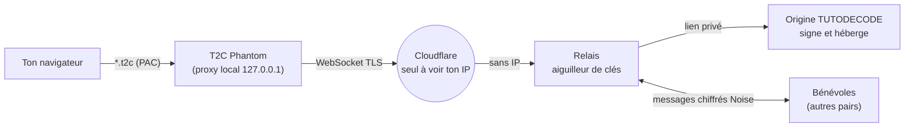

# Comment fonctionne T2C Phantom

## En une image

1. Tu ouvres `https://tutodecode.t2c`. Le navigateur demande au **fichier PAC** où envoyer cette requête : seuls les noms en `.t2c` partent vers T2C Phantom, tout le reste reste direct.
2. T2C Phantom regarde le **catalogue signé** pour trouver le site, puis télécharge ses morceaux **en parallèle chez plusieurs bénévoles**, à travers le relais.
3. Chaque morceau est **vérifié** contre l'empreinte signée par TUTODECODE. Si aucun bénévole n'a un morceau, il vient de l'origine, par le même chemin.
4. Le site, reconstitué et vérifié, est servi à ton navigateur. Le cadenas HTTPS vient d'un certificat local **limité aux noms `.t2c`**.

## Les acteurs

| Acteur | Rôle | Code |
|---|---|---|
| **Toi (pair)** | télécharge, vérifie, peut héberger une copie | ce dépôt (public) |
| **Bénévoles** | gardent une copie vérifiée et la fournissent aux autres | ce dépôt (public) |
| **Relais** | aiguille des messages chiffrés entre clés, sert le catalogue signé, contrôle les bénévoles | privé |
| **Origine** | héberge et **signe** les sites, délivre les tickets de bénévolat, tient les scores | privé |
| **Cloudflare** | point d'entrée public, protège le relais (anti-DDoS) | — |

## Identité pseudonyme

- Au premier lancement, ton application génère une **clé Ed25519 au hasard**. Ton identifiant (32 caractères) en est dérivé. Il n'y a ni compte, ni email, ni lien avec ton nom ou ton IP.
- Créer une identité demande une **petite preuve de travail** (quelques secondes de calcul). Un pair banni ne peut donc pas se recréer des milliers d'identités gratuitement.
- Une seconde clé (X25519), signée par la première, sert au **chiffrement de bout en bout** avec les autres pairs.
- Fichier : `identity.json` dans le dossier de données. Le supprimer crée une nouvelle identité ; le score repart alors de zéro.

## Authenticité et intégrité des sites

- L'origine publie un **catalogue signé** (Ed25519). Il liste les sites et l'empreinte de chacun. Sa version ne peut qu'augmenter : un vieux catalogue rejoué est refusé.
- Chaque site est découpé en **morceaux de 256 Ko**. Le **manifeste signé** donne l'empreinte SHA-256 de chaque morceau.
- Ton client connaît la **clé publique de TUTODECODE**, inscrite dans l'application. Il refuse tout document mal signé et tout morceau dont l'empreinte ne correspond pas.

La clé racine de TUTODECODE n'est **jamais sur un serveur** : les sites sont signés hors ligne, sur le poste de l'éditeur, puis envoyés au serveur sous forme de paquet qu'il revérifie entièrement. Le serveur ne possède qu'une **clé de service déléguée** (durée limitée), autorisée à signer uniquement les tickets et la liste des bénévoles.

Conséquence : **ni un bénévole, ni le relais, ni Cloudflare, ni même un serveur d'origine piraté ne peut modifier un site** sans que ce soit détecté. Un morceau modifié est rejeté, l'expéditeur est banni localement et signalé.

## Bénévoles, tickets et score

1. Pour héberger un site, ton client demande un **ticket** à l'origine, en passant par le relais. Le ticket est signé et lié à ta clé et à la version du site.
2. Il récupère une copie vérifiée du site, puis l'**annonce** au relais.
3. Le relais te **contrôle** régulièrement : il t'envoie un défi aléatoire, `H(nonce ‖ morceau)`, que seul un pair possédant vraiment le morceau intact peut résoudre.
4. Contrôle réussi : ton score monte. Contrôle raté : ticket révoqué. Échecs répétés : ta clé est **bannie** dans la liste signée `hosts.json`.

Les téléchargeurs choisissent en priorité les bénévoles les mieux notés, à la fois par l'origine et par leur propre expérience.

## Plusieurs relais (fédération)

Le réseau peut compter plusieurs relais, tenus par des opérateurs de confiance et listés avec leur clé dans la liste signée. Ton application en choisit un au hasard, ce qui répartit la charge.

Les relais se relient entre eux par une liaison authentifiée des deux côtés. Ils partagent l'annuaire des bénévoles et se transmettent les échanges chiffrés : tu peux télécharger chez un bénévole connecté à un autre relais que le tien. Un seul relais joint le serveur d'origine ; les autres passent par lui et ne connaissent jamais son adresse.

Chaque relais ne voit que l'IP des personnes qui se connectent à lui, jamais le contenu des échanges entre membres.

## Mode anonyme (routage en oignon)

Dès que le réseau compte au moins deux relais, l'application passe d'elle-même en mode anonyme (badge « Anonyme » en haut de la fenêtre) :

- tes demandes traversent un **circuit** de 2 ou 3 relais différents, chiffré une fois par relais ;
- le **relais d'entrée** connaît ton adresse IP mais ne peut rien lire de ce que tu demandes ;
- le **relais de sortie** lit les demandes (quel site, quels morceaux) mais ne connaît ni ton IP ni ton identité : seulement un **pseudonyme jetable**, renouvelé toutes les 10 minutes ;
- les **bénévoles** ne voient que ce pseudonyme ;
- chaque relais négocie des clés éphémères : même une clé de relais volée plus tard ne déchiffre pas un échange passé ;
- **échec fermé** : si le circuit tombe, l'application n'envoie rien en clair à la place, elle en reconstruit un.

Limites : l'anonymat suppose que les relais du circuit ne s'entendent pas entre eux (comme pour Tor). Le rôle de bénévole n'est pas anonyme vis-à-vis de son relais, qui sait quels sites il héberge. Avec un seul relais dans le réseau, le mode anonyme reste inactif.

## Chiffrement de bout en bout

Les échanges entre deux pairs utilisent le protocole **Noise IK** (X25519, ChaCha20-Poly1305, BLAKE2s). Le relais transmet les messages sans pouvoir les lire ni les modifier. Il ne voit que leur taille et les deux clés concernées.

## Qui voit quoi

| | Ton IP | Ta clé | Sites que tu demandes | Contenu échangé entre pairs |
|---|---|---|---|---|
| **Cloudflare** | oui | oui | oui | non (chiffré) |
| **Relais** | non | oui | oui | non (chiffré) |
| **Origine** | non | seulement si tu es bénévole | non | — |
| **Autres pairs** | non | oui | seulement ce qu'ils te fournissent | — |

Le relais ne lit aucun en-tête contenant une adresse IP, et l'origine refuse toute requête qui en porterait une. Les métadonnées (qui demande quel site, quelles clés échangent entre elles) restent visibles par Cloudflare et par le relais : c'est un choix assumé. L'objectif est de **protéger les adresses IP**, pas de rendre la navigation intraçable comme Tor.

## Configuration des navigateurs

Quand tu cliques sur « Configurer automatiquement » :

| Système | Certificat `.t2c` | Proxy (PAC) |
|---|---|---|
| macOS | trousseau de session (+ profils Firefox / Zen si `certutil` est présent) | chaque service réseau (Wi-Fi, Ethernet…) |
| Windows | magasin « Racines de confiance » de l'utilisateur | réglage Internet de l'utilisateur (Edge, Chrome, Firefox) |
| Linux | bases NSS de Chrome/Chromium et Firefox (`certutil`) | GNOME ; ailleurs, réglage manuel indiqué |

Firefox, Zen et LibreWolf sont réglés pour lire les certificats du système (`security.enterprise_roots.enabled`). Le certificat porte une **contrainte de nom (`.t2c`)** respectée par tous les navigateurs modernes. Les réglages proxy d'origine sont sauvegardés et **remis à la fermeture** de l'application.

## Limites connues

- **Tout passe par le relais** : les pairs ne se connectent jamais directement, sinon ils verraient leurs IP. La bande passante du relais est donc la limite. Plusieurs relais sont prévus (v2.1).
- **Cloudflare** voit ton IP et les sites demandés.
- **Applications non signées** par Apple et Microsoft : un avertissement s'affiche au premier lancement.
- Un **poste compromis** (logiciel malveillant) est hors de portée de toute protection réseau.
